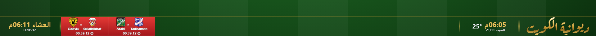

# 🇰🇼 ديوانية الكويت — شريط التلفزيون الذكي
### Diwaniya Kuwait — Smart TV Overlay Ticker for Android TV boxes

**شريط أنيق يظهر أسفل شاشة التلفزيون فوق تطبيقات البث: الساعة، الحرارة، الصلاة، المباريات، العطل، رمضان، أخبار كونا، تنبيهات الطوارئ، وباركود واي فاي الضيوف — مع ساعة ذهبية فاخرة كشاشة توقف.**

### ⭐ إذا عجبك المشروع، لا تنسى تعطيه نجمة ⭐
### ⭐ If you like this project, please give it a star! ⭐

---

## 📺 الصور | Screenshots

| الشريط فوق البث | شاشة التوقف (الساعة الذهبية) |
|---|---|
|  |  |

---

## ✨ المميزات

| | الميزة | التفاصيل |
|---|---|---|
| 🕐 | **الساعة والتاريخ** | بتوقيت الكويت، هجري وميلادي |
| 🌡️ | **الحرارة** | تحديث تلقائي من open-meteo |
| 🕌 | **الصلاة القادمة** | مع عدّاد تنازلي (aladhan — طريقة الكويت) |
| ⚽ | **المباريات** | الدوري الكويتي + الدوريات الكبرى بشعارات الأندية. أخضر قبل ساعتين، أحمر قبل ساعة، وتختصر بعد البداية |
| 🏖️ | **العطل الرسمية** | من ملف `holidays.json` |
| 🌙 | **رمضان والعيد** | إمساكية + تهنئة العيد |
| 📰 | **أخبار كونا** | الأخبار المهمة فقط |
| 🚨 | **تنبيهات الطوارئ** | تنبيه الهجمات والغبار (مع شرط مدى الرؤية) |
| 📶 | **باركود واي فاي الضيوف** | الضيف يصوّر ويتصل مباشرة |
| ✍️ | **«ديوانية الكويت»** | بخط الرقعة الذهبي |
| 🕰️ | **شاشة توقف** | ساعة ذهبية فاخرة تطلع بعد دقيقتين بدون استخدام، أو فوراً عند كتم الصوت |
| 🔌 | **بدون لابتوب** | يشتغل على الرسيفر لحاله، ويبدأ تلقائياً مع تشغيل الجهاز |

---

## 🚀 التثبيت على الرسيفر

1. نزّل ملف التطبيق **[`DiwaniyaKuwait.apk`](DiwaniyaKuwait.apk)** على الرسيفر (مثلاً عن طريق تطبيق Downloader).
2. ثبّته وافتحه مرة وحدة.
3. فعّل له **«الوصول إلى بيانات الاستخدام»** عشان يعرف متى تكون في تطبيق البث.
4. فعّل له **«إمكانية الوصول»** عشان تشتغل الساعة الذهبية.
5. خلاص، الشريط يطلع تلقائياً فوق تطبيقات البث. ✅

> مجرّب على رسيفر **Z6 أندرويد 10**، ويفترض يشتغل على أي جهاز Android TV.

---

## 🛠️ التخصيص

| الملف | الاستخدام |
|---|---|
| `source/ticker-src.html` | تصميم الشريط وإعداداته (`CONFIG`) |
| `source/saver-src.html` | الساعة الذهبية |
| `wifi.json` | اسم شبكة الضيوف وكلمة السر للباركود (`show: true`) |
| `holidays.json` | العطل الرسمية |
| `apps.json` | التطبيقات اللي يظهر فوقها الشريط، ومدة شاشة التوقف |

**تغيير اسم الديوانية:** غيّر النص «ديوانية الكويت» في `source/ticker-src.html` و `source/saver-src.html`، ثم شغّل `publish.ps1`.

**بناء التطبيق بنفسك:** `app/build.ps1` يبني الـ APK بدون Gradle (aapt2 ← javac ← d8 ← apksigner)، ويحتاج JDK و Android SDK (build-tools 34 + platform 22).

**سيرفر اختياري على الكمبيوتر:** `server.py` (بايثون، منفذ 8765) لتحديث الشريط عن بُعد. عدّل العنوان `192.168.1.100` في `BarService.java` و `ticker-src.html` إلى عنوان جهازك.

---

## 🇬🇧 English

**Diwaniya Kuwait** is an Arabic overlay ticker for Android TV boxes. It shows a thin, transparent bar at the bottom of the TV, on top of streaming apps, with:

- ⏰ Kuwait clock and date (Hijri and Gregorian)
- 🌡️ Temperature
- 🕌 Next prayer with a countdown
- ⚽ Live football fixtures with club logos (Kuwaiti league and major leagues)
- 🏖️ Public holidays and 🌙 Ramadan/Eid
- 📰 KUNA headlines and 🚨 emergency/dust alerts
- 📶 A guest Wi-Fi QR code

It also includes a gold-clock screensaver. It runs fully on the device with no PC needed, and starts on boot.

**Install:** sideload `DiwaniyaKuwait.apk`, then grant *Usage access* and *Accessibility*.

**Build:** `app/build.ps1` (a Gradle-less pipeline: aapt2 → javac → d8 → zipalign → apksigner).

**Keywords:** Kuwait, Android TV, overlay, ticker, prayer times, football scores, Arabic, diwaniya, IPTV, screensaver, الكويت، ديوانية، رسيفر، شريط أخبار، مواقيت الصلاة، مباريات

---

## 🤝 المساهمة | Contributing

الاقتراحات والتحسينات مرحّب فيها، افتح **Issue** أو **Pull Request**.
Suggestions and pull requests are welcome!

## 📜 الرخصة | License

- **الكود:** رخصة MIT. شوف ملف [LICENSE](LICENSE).
- **الخطوط:** Aref Ruqaa و Amiri برخصة SIL Open Font License.
- **مكتبة الباركود:** qrcode.js برخصة MIT.

### ⭐ لا تنسى النجمة — كل نجمة تساعد المشروع يوصل لأكثر الناس ⭐

صُنع بحب في الكويت 🇰🇼

