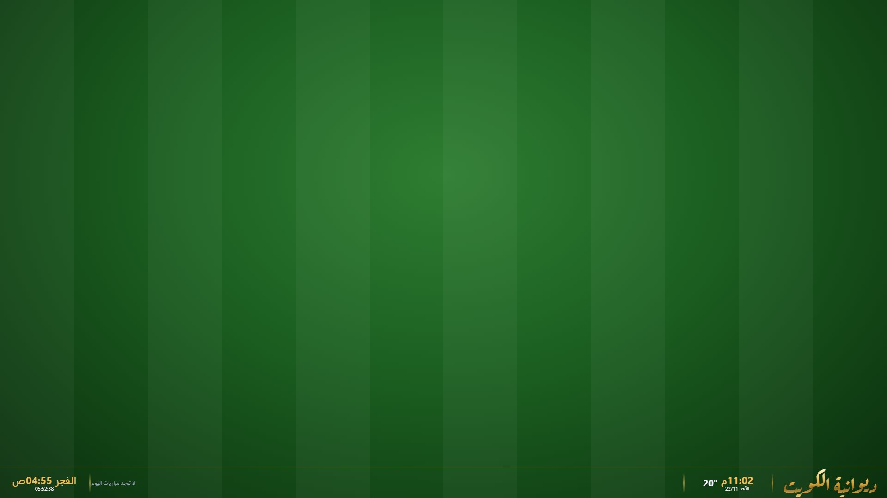
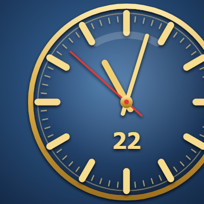

<div align="center">


# 🇰🇼 ديوانية الكويت — شريط التلفزيون الذكي
### Diwaniya Kuwait — Smart TV Overlay Ticker

**شريط شفاف وأنيق يركب على رسيفر الأندرويد والتلفزيون، ويظهر أسفل الشاشة فوق تطبيقات البث. فيه كل اللي تحتاجه الديوانية والبيت: الوقت والصلاة والمباريات والأخبار والتنبيهات المهمة.**

**A thin, transparent overlay bar for Android TV boxes that sits on top of your streaming apps with the time, prayer times, football, news and important alerts for Kuwaiti diwaniyas and homes.**


### ⭐ إذا عجبك المشروع، لا تنسى تعطيه نجمة | Please give it a star ⭐


🌐 **الموقع | Website:** https://29kuwait.github.io/diwaniya-kuwait/

[العربية](#العربية) · [English](#english)

</div>

---

## العربية

### 🎯 وش هو؟

تطبيق أندرويد مجاني ومفتوح المصدر، يعرض شريطاً شفافاً أسفل شاشة التلفزيون فوق تطبيقات البث (IPTV وغيرها)، بدون ما يقطع عليك المشاهدة. صُمم لاحتياج **الديوانيات والبيوت في الكويت**: تعرف الوقت ووقت الصلاة والمباراة الجاية وآخر الأخبار والتنبيهات، وأنت تتفرج.

### 🧩 شريطان في مشروع واحد

| | **الشريط الأساسي** | **الشريط البسيط** |
|---|---|---|
| الملف | `DiwaniyaKuwait.apk` | [`simple-bar/DiwaniyaKuwait-SimpleBar.apk`](simple-bar/) |
| لأي جهاز | **كل أجهزة Android TV من أندرويد 5 لين أحدثها** (مجرّب على Z6 أندرويد 10، وعلى رسيفر أندرويد 5.1) | الأجهزة القديمة مثل Eurostar ES4000 (أندرويد 5.1) |
| الحجم | حوالي 350 كيلوبايت | حوالي 80 كيلوبايت |
| ارتفاع الشريط | 6% من الشاشة | 4.6% من الشاشة |
| الميزات | الساعة والحرارة والصلاة والمباريات والعطل ورمضان والأخبار وتنبيهات القصف والطقس والساعة الدائرية الشفافة والساعة الذهبية | الطقس والساعة والتاريخ والصلاة القادمة بعدّاد تنازلي |
| يحتاج سيرفر؟ | لا (السيرفر اختياري) | لا |

تفاصيل الشريط البسيط ومقاساته ومميزاته: [simple-bar/README.md](simple-bar/README.md)

### 📺 الصور

| الشريط فوق البث | الساعة الدائرية بالزاوية | شاشة التوقف (الساعة الذهبية) |
|---|---|---|
|  |  |  |

### ✨ المميزات

| | الميزة | التفاصيل |
|---|---|---|
| 🕐 | **الساعة والتاريخ** | بتوقيت الكويت الثابت (UTC+3) مهما كان ضبط الرسيفر، هجري وميلادي |
| 🌡️ | **الحرارة** | تحديث تلقائي من open-meteo |
| 🕌 | **الصلاة القادمة** | مع عدّاد تنازلي، بطريقة حساب الكويت (aladhan) |
| ⚽ | **المباريات** | مباريات اليوم من ESPN بشعارات الأندية، بدون مفتاح. تظهر قبل البداية بساعتين، وتصير **حمراء مع عدّاد** آخر ساعة، و**خضراء** أول ربع ساعة من المباراة، وبعدها تصغر، وتختفي لما تخلص. أسماء الأندية الطويلة تنختصر تلقائياً، والمباريات تتحدث مرة باليوم |
| 🏖️ | **العطل الرسمية** | من ملف `holidays.json`، وتقدر تعدّله |
| 🌙 | **رمضان والعيد** | إعلان الرؤية وإمساكية وتهنئة العيد |
| 📰 | **أخبار كونا** | الخبر المهم فقط، بدون تكرار، بشريط بسمك الشريط كامل |
| 🚨 | **تنبيهات الطقس** | غبار (مع شرط إن الرؤية أقل من 5 كم)، عواصف رعدية، أمطار، ضباب، حر شديد، رياح قوية |
| ⚠️ | **تنبيه الهجمات** | من عناوين الأخبار (مسيّرة / صاروخ)، يبقى 12 ساعة. **مو نظام إنذار رسمي** (شوف التنبيه تحت) |
| ⏱️ | **ساعة دائرية شفافة بالزاوية** | فوق يمين الشاشة: إطار ذهبي، وعلامات ساعات عريضة مع ظل، وعقرب ثواني أحمر، وتحتها رقم اليوم |
| ✍️ | **«ديوانية الكويت»** | بخط الرقعة الذهبي |
| 🕰️ | **شاشة توقف** | ساعة ذهبية فاخرة تطلع بعد دقيقتين بدون استخدام، أو فوراً عند كتم الصوت، وتختفي أول ما تضغط أي زر |
| 🎯 | **فوق البث بس** | يطلع فوق تطبيقات البث (IPTV، يوتيوب، شاهد، نتفلكس، VLC...)، وشاشة الرسيفر الرئيسية ما تتغير |
| 📱 | **كل الأجهزة** | يشتغل حتى على الرسيفرات القديمة (أندرويد 5): الصفحات تتحوّل لصيغة يفهمها المتصفح القديم، والخطوط بصيغة WOFF |
| 🔌 | **يشتغل لحاله** | على الرسيفر بدون لابتوب، ويبدأ تلقائياً مع تشغيل الجهاز |

> ### ⚠️ تنبيه مهم
> تنبيهات الأخبار (مثل الهجمات) مصدرها **عناوين أخبار منشورة** (Google News)، وليست نظام إنذار رسمي. قد تتأخر وقد تخطئ. لا تعتمد عليها للسلامة، وتابع الجهات الرسمية دائماً.

### 🚀 التثبيت على الرسيفر

1. نزّل ملف `DiwaniyaKuwait.apk` على الرسيفر (مثلاً بتطبيق Downloader).
2. ثبّته وافتحه مرة وحدة.
3. فعّل له **«الوصول إلى بيانات الاستخدام»** عشان يعرف متى تكون داخل تطبيق البث.
4. فعّل له **«إمكانية الوصول»** عشان تشتغل الساعة الذهبية.
5. خلاص، الشريط يطلع تلقائياً فوق تطبيقات البث ✅

مجرّب على رسيفر **Z6 أندرويد 10** وعلى رسيفر **أندرويد 5.1**.

> **الرسيفرات القديمة (أندرويد 5):** بعضها يلغي صلاحية «إمكانية الوصول» بعد كل تحديث للتطبيق، فرجّع فعّلها. وإذا منفذ adb (5555) مفتوح، تقدر تفعّل كل شي من الكمبيوتر:
> ```
> adb install -r DiwaniyaKuwait.apk
> adb shell appops set com.diwaniya.kuwait GET_USAGE_STATS allow
> adb shell settings put secure enabled_accessibility_services com.diwaniya.kuwait/com.diwaniya.kuwait.DiwanAccess
> adb shell settings put secure accessibility_enabled 1
> ```

> أندرويد 11 وما فوق يشدد على صلاحية الظهور فوق التطبيقات (`SYSTEM_ALERT_WINDOW`). إذا ما ظهر الشريط، فعّلها من إعدادات التطبيقات.

### 🛠️ التخصيص

| الملف | الاستخدام |
|---|---|
| `source/ticker-src.html` | تصميم الشريط وإعداداته (`CONFIG`: المدينة، حدود الحر والغبار والرياح، سرعة الحركة...) |
| `source/saver-src.html` | الساعة الذهبية |
| `wifi.json` | اختياري: باركود واي فاي الضيوف لنسخة المتصفح (`show: true` لتفعيله) |
| `holidays.json` | العطل الرسمية |
| `apps.json` | التطبيقات اللي يظهر فوقها الشريط، ومدة شاشة التوقف |

**تغيير اسم الديوانية:** غيّر النص «ديوانية الكويت» في `source/ticker-src.html` و `source/saver-src.html`، ثم شغّل `publish.ps1`.

**بناء التطبيق بنفسك:** أول مرة ثبّت Node.js وشغّل `npm install` داخل `tools-legacy` (يحوّل الصفحات لصيغة تشتغل على الأجهزة القديمة)، وبعدها `publish.ps1`، ثم `app/build.ps1` يبني الـ APK بدون Gradle (aapt2 ← javac ← d8 ← apksigner)، ويحتاج JDK و Android SDK (build-tools 34 + platform 22).

**سيرفر اختياري على الكمبيوتر:** `server.py` (بايثون، منفذ 8765) لتحديث الشريط عن بُعد. عدّل العنوان `192.168.1.100` في `BarService.java` و `ticker-src.html` إلى عنوان جهازك.

### 🔐 الأمان

- **لا ترفع باسورد الواي فاي الحقيقي على GitHub.** الملف `wifi.json` في المشروع فيه قيم وهمية (`CHANGE-ME`). عدّله على نسختك المحلية فقط، ولا تعمل له commit بعد ما تكتب الباسورد.
- لا ترفع مفاتيح التوقيع (`*.jks` و `*.keystore`)، وهي أصلاً مستثناة في `.gitignore`.
- `server.py` بدون باسورد، ومصمم لشبكة البيت فقط. **لا تفتح المنفذ 8765 على الإنترنت** (لا تسوي Port Forwarding). الكود ينظف أي نص يوصله من الشبكة قبل ما يكتبه.

### 🗺️ خطة التطوير

أفكار نشتغل عليها، وما هي جاهزة بعد:

- [ ] شاشة إعدادات داخل التطبيق (اسم الديوانية، الواي فاي، التطبيقات) بدون تعديل كود
- [ ] شاشة ترحيب تشرح الصلاحيات خطوة بخطوة بالريموت
- [ ] لوحة تحكم من الجوال عبر QR (إخفاء الشريط، رسالة ترحيب عاجلة)
- [ ] حماية شاشات OLED من الاحتراق (إزاحة بسيطة للشريط كل فترة)
- [ ] ثيمات جاهزة (ذهبي، كويتي، رياضي داكن)
- [ ] إعداد عنوان السيرفر من داخل التطبيق بدل تعديل الكود
- [ ] نشر الـ APK في صفحة Releases وبناؤه تلقائياً عبر GitHub Actions

### 🤝 المساهمة

الاقتراحات والتحسينات مرحّب فيها. شوف [CONTRIBUTING.md](CONTRIBUTING.md)، أو افتح [Issue](https://github.com/29kuwait/diwaniya-kuwait/issues).

---

## English

### 🎯 What is it?

A free, open-source Android app that shows a thin transparent bar at the bottom of your TV, on top of streaming apps (IPTV and others), without interrupting what you watch. It is designed for **Kuwaiti diwaniyas and homes**: see the time, the next prayer, the next match, the latest news and alerts while you watch.

### 🧩 Two bars in one project

| | **Main bar** | **Simple Bar** |
|---|---|---|
| File | `DiwaniyaKuwait.apk` | [`simple-bar/DiwaniyaKuwait-SimpleBar.apk`](simple-bar/) |
| For | **Every Android TV from Android 5 up** (tested on Z6 Android 10 and an Android 5.1 box) | Older boxes such as the Eurostar ES4000 (Android 5.1) |
| Size | about 350 KB | about 80 KB |
| Bar height | 6% of the screen | 4.6% of the screen |
| Features | Clock, temperature, prayer, matches, holidays, Ramadan, news, attack and weather alerts, the transparent corner clock and the gold clock | Weather, clock and date, next prayer with a countdown |
| Needs a server? | No (the server is optional) | No |

Details, sizes and features of the Simple Bar: [simple-bar/README.md](simple-bar/README.md)

### ✨ Features

| | Feature | Details |
|---|---|---|
| 🕐 | **Clock and date** | Fixed Kuwait time (UTC+3) regardless of the box's timezone, Hijri and Gregorian |
| 🌡️ | **Temperature** | Auto-updated from open-meteo |
| 🕌 | **Next prayer** | With a countdown, using the Kuwait calculation method (aladhan) |
| ⚽ | **Football** | Today's matches from ESPN with club logos, no API key. Shown 2 hours before kickoff, turns **red with a countdown** in the last hour and **green** for the first 15 minutes, then shrinks and hides when finished. Long club names are abbreviated; fixtures refresh once a day |
| 🏖️ | **Public holidays** | From an editable `holidays.json` |
| 🌙 | **Ramadan and Eid** | Moon-sighting announcements, imsakiyah and Eid greetings |
| 📰 | **KUNA news** | Important headlines only, no repeats, as a full-height card |
| 🚨 | **Weather alerts** | Dust (only when visibility is under 5 km), thunderstorms, rain, fog, extreme heat, strong wind |
| ⚠️ | **Attack alerts** | Based on news headlines (drone / missile), kept for 12 hours. **Not an official warning system** (see the note below) |
| ⏱️ | **Transparent corner clock** | Top-right analog clock with a gold frame, bold shadowed hour marks, a red second hand and today's date |
| ✍️ | **"Diwaniya Kuwait"** | In golden Ruqaa calligraphy |
| 🕰️ | **Screensaver** | A luxurious gold clock after 2 idle minutes, or instantly on mute; any key dismisses it |
| 🎯 | **Streaming apps only** | Appears over IPTV, YouTube, Shahid, Netflix, VLC...; the home screen is untouched |
| 📱 | **All devices** | Works on old Android 5 boxes too: pages are transpiled to ES5 with polyfills and fonts ship as WOFF |
| 🔌 | **Runs standalone** | On the box with no PC, and starts on boot |

> ### ⚠️ Important
> News-based alerts (such as attacks) come from **published news headlines** (Google News), not from an official warning system. They can be late or wrong. Do not rely on them for safety; always follow official authorities.

### 🚀 Install

1. Download `DiwaniyaKuwait.apk` on your box (for example with the Downloader app).
2. Install it and open it once.
3. Grant **Usage access** so it knows when a streaming app is open.
4. Grant **Accessibility** for the gold-clock screensaver.
5. Done. The bar appears over your streaming apps automatically ✅

Tested on a **Z6 box (Android 10)** and an **Android 5.1 box**. Some Android 5 boxes turn Accessibility off after every app update; re-enable it (or use the adb commands in the Arabic section). On Android 11+, you may need to allow *Display over other apps* (`SYSTEM_ALERT_WINDOW`).

### 🛠️ Customize

| File | Purpose |
|---|---|
| `source/ticker-src.html` | Bar design and settings (`CONFIG`: city, heat/dust/wind thresholds, scroll speed...) |
| `source/saver-src.html` | The gold clock |
| `wifi.json` | Optional: guest Wi-Fi QR for the browser version (set `show: true`) |
| `holidays.json` | Public holidays |
| `apps.json` | Apps the bar appears over, and screensaver timing |

**Rename the diwaniya:** change the text "ديوانية الكويت" in `source/ticker-src.html` and `source/saver-src.html`, then run `publish.ps1`.

**Build it yourself:** first install Node.js and run `npm install` in `tools-legacy` (makes the pages work on old devices), then run `publish.ps1`, then `app/build.ps1` builds the APK without Gradle (aapt2 → javac → d8 → zipalign → apksigner). It needs a JDK and the Android SDK (build-tools 34 + platform 22).

**Optional PC server:** `server.py` (Python, port 8765) for remote updates. Change `192.168.1.100` in `BarService.java` and `ticker-src.html` to your PC's address.

### 🔐 Security

- **Never commit your real Wi-Fi password.** `wifi.json` ships with placeholder values (`CHANGE-ME`). Edit it only on your local copy and do not commit it afterwards.
- Never commit signing keys (`*.jks`, `*.keystore`); they are already in `.gitignore`.
- `server.py` has no password and is meant for your home network only. **Never expose port 8765 to the internet** (no port forwarding). The code sanitizes any text it receives from the network before writing it.

### 🗺️ Roadmap

Ideas we are working on; not ready yet:

- [ ] In-app settings screen (diwaniya name, Wi-Fi, apps) with no code edits
- [ ] A welcome screen that guides permissions step by step with the remote
- [ ] Phone control panel via QR (hide the bar, urgent welcome message)
- [ ] OLED burn-in protection (small periodic pixel shift)
- [ ] Ready-made themes (gold, Kuwaiti, dark sports)
- [ ] Server address setting inside the app instead of editing code
- [ ] Publish the APK in Releases and build it automatically with GitHub Actions

### 🤝 Contributing

Suggestions and pull requests are welcome. See [CONTRIBUTING.md](CONTRIBUTING.md) or open an [issue](https://github.com/29kuwait/diwaniya-kuwait/issues).

---

## 📜 الرخصة | License

الكود: رخصة MIT (ملف LICENSE). الخطوط: Aref Ruqaa و Amiri برخصة SIL Open Font License. مكتبة الباركود: qrcode.js برخصة MIT.
Code: MIT (see LICENSE). Fonts: Aref Ruqaa and Amiri under the SIL Open Font License. QR library: qrcode.js under MIT.

<div align="center">

⭐ إذا عجبك المشروع، لا تنسى النجمة | If you like it, please give it a star ⭐

**صُنع بحب في الكويت 🇰🇼 | Made with love in Kuwait**

</div>
