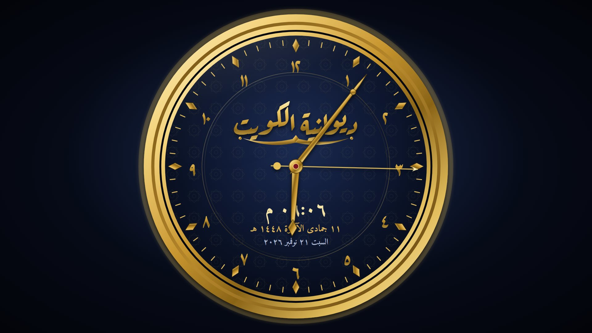

# 🇰🇼 ديوانية الكويت — شريط التلفزيون الذكي
### Diwaniya Kuwait — Smart TV Overlay Ticker

**شريط شفاف وأنيق يركب على رسيفر الأندرويد والتلفزيون، ويظهر أسفل الشاشة فوق تطبيقات البث. فيه كل اللي تحتاجه الديوانية والبيت: الوقت والصلاة والمباريات والأخبار والتنبيهات المهمة.**

**A thin, transparent overlay bar for Android TV boxes that sits on top of your streaming apps with the time, prayer times, football, news and important alerts for Kuwaiti diwaniyas and homes.**

[العربية](#العربية) · [English](#english)

---

## العربية

### 🎯 وش هو؟

تطبيق أندرويد مجاني ومفتوح المصدر، يعرض شريطاً شفافاً أسفل شاشة التلفزيون فوق تطبيقات البث (IPTV وغيرها)، بدون ما يقطع عليك المشاهدة. صُمم لاحتياج **الديوانيات والبيوت في الكويت**: تعرف الوقت ووقت الصلاة والمباراة الجاية وآخر الأخبار والتنبيهات، وأنت تتفرج.

### 📺 الصور

| الشريط فوق البث | شاشة التوقف (الساعة الذهبية) |
|---|---|
|  |  |

### ✨ المميزات

| | الميزة | التفاصيل |
|---|---|---|
| 🕐 | **الساعة والتاريخ** | بتوقيت الكويت الثابت (UTC+3) مهما كان ضبط الرسيفر، هجري وميلادي |
| 🌡️ | **الحرارة** | تحديث تلقائي من open-meteo |
| 🕌 | **الصلاة القادمة** | مع عدّاد تنازلي، بطريقة حساب الكويت (aladhan) |
| ⚽ | **المباريات** | مباريات اليوم من ESPN بشعارات الأندية، بدون مفتاح. تظهر قبل البداية بساعتين، وتصير حمراء مع عدّاد قبل ساعة، وتصغر بعد البداية |
| 🏖️ | **العطل الرسمية** | من ملف `holidays.json`، وتقدر تعدّله |
| 🌙 | **رمضان والعيد** | إعلان الرؤية وإمساكية وتهنئة العيد |
| 📰 | **أخبار كونا** | الخبر المهم فقط، بدون تكرار |
| 🚨 | **تنبيهات الطقس** | غبار (مع شرط قلة الرؤية)، حر شديد، رياح قوية |
| ⚠️ | **تنبيه الهجمات** | من عناوين الأخبار (مسيّرة / صاروخ)، يبقى 12 ساعة. **مو نظام إنذار رسمي** (شوف التنبيه تحت) |
| 📶 | **باركود واي فاي الضيوف** | الضيف يصوّر ويتصل مباشرة |
| ✍️ | **«ديوانية الكويت»** | بخط الرقعة الذهبي |
| 🕰️ | **شاشة توقف** | ساعة ذهبية فاخرة تطلع بعد دقيقتين بدون استخدام، أو فوراً عند كتم الصوت |
| 🔌 | **يشتغل لحاله** | على الرسيفر بدون لابتوب، ويبدأ تلقائياً مع تشغيل الجهاز |

> ### ⚠️ تنبيه مهم
> تنبيهات الأخبار (مثل الهجمات) مصدرها **عناوين أخبار منشورة** (Google News)، وليست نظام إنذار رسمي. قد تتأخر وقد تخطئ. لا تعتمد عليها للسلامة، وتابع الجهات الرسمية دائماً.

### 🚀 التثبيت على الرسيفر

1. نزّل ملف `DiwaniyaKuwait.apk` على الرسيفر (مثلاً بتطبيق Downloader).
2. ثبّته وافتحه مرة وحدة.
3. فعّل له **«الوصول إلى بيانات الاستخدام»** عشان يعرف متى تكون داخل تطبيق البث.
4. فعّل له **«إمكانية الوصول»** عشان تشتغل الساعة الذهبية.
5. خلاص، الشريط يطلع تلقائياً فوق تطبيقات البث ✅

مجرّب على رسيفر **Z6 أندرويد 10**، ويفترض يشتغل على أي جهاز Android TV.

> أندرويد 11 وما فوق يشدد على صلاحية الظهور فوق التطبيقات (`SYSTEM_ALERT_WINDOW`). إذا ما ظهر الشريط، فعّلها من إعدادات التطبيقات.

### 🛠️ التخصيص

| الملف | الاستخدام |
|---|---|
| `source/ticker-src.html` | تصميم الشريط وإعداداته (`CONFIG`: المدينة، حدود الحر والغبار والرياح، سرعة الحركة...) |
| `source/saver-src.html` | الساعة الذهبية |
| `wifi.json` | اسم شبكة الضيوف وكلمة السر للباركود (`show: true` لتفعيله) |
| `holidays.json` | العطل الرسمية |
| `apps.json` | التطبيقات اللي يظهر فوقها الشريط، ومدة شاشة التوقف |

**تغيير اسم الديوانية:** غيّر النص «ديوانية الكويت» في `source/ticker-src.html` و `source/saver-src.html`، ثم شغّل `publish.ps1`.

**بناء التطبيق بنفسك:** `app/build.ps1` يبني الـ APK بدون Gradle (aapt2 ← javac ← d8 ← apksigner)، ويحتاج JDK و Android SDK (build-tools 34 + platform 22).

**سيرفر اختياري على الكمبيوتر:** `server.py` (بايثون، منفذ 8765) لتحديث الشريط عن بُعد. عدّل العنوان `192.168.1.100` في `BarService.java` و `ticker-src.html` إلى عنوان جهازك.

### 🔐 الأمان

- **لا ترفع باسورد الواي فاي الحقيقي على GitHub.** الملف `wifi.json` في المشروع فيه قيم وهمية (`CHANGE-ME`). عدّله على نسختك المحلية فقط، ولا تعمل له commit بعد ما تكتب الباسورد.
- لا ترفع مفاتيح التوقيع (`*.jks` و `*.keystore`)، وهي أصلاً مستثناة في `.gitignore`.

### 🗺️ خطة التطوير

أفكار نشتغل عليها، وما هي جاهزة بعد:

- [ ] شاشة إعدادات داخل التطبيق (اسم الديوانية، الواي فاي، التطبيقات) بدون تعديل كود
- [ ] شاشة ترحيب تشرح الصلاحيات خطوة بخطوة بالريموت
- [ ] لوحة تحكم من الجوال عبر QR (إخفاء الشريط، رسالة ترحيب عاجلة)
- [ ] حماية شاشات OLED من الاحتراق (إزاحة بسيطة للشريط كل فترة)
- [ ] ثيمات جاهزة (ذهبي، كويتي، رياضي داكن)
- [ ] إعداد عنوان السيرفر من داخل التطبيق بدل تعديل الكود
- [ ] نشر الـ APK في صفحة Releases وبناؤه تلقائياً عبر GitHub Actions

### 🤝 المساهمة

الاقتراحات والتحسينات مرحّب فيها. شوف [CONTRIBUTING.md](CONTRIBUTING.md)، أو افتح [Issue](https://github.com/29kuwait/diwaniya-kuwait/issues).

---

## English

### 🎯 What is it?

A free, open-source Android app that shows a thin transparent bar at the bottom of your TV, on top of streaming apps (IPTV and others), without interrupting what you watch. It is designed for **Kuwaiti diwaniyas and homes**: see the time, the next prayer, the next match, the latest news and alerts while you watch.

### ✨ Features

| | Feature | Details |
|---|---|---|
| 🕐 | **Clock and date** | Fixed Kuwait time (UTC+3) regardless of the box's timezone, Hijri and Gregorian |
| 🌡️ | **Temperature** | Auto-updated from open-meteo |
| 🕌 | **Next prayer** | With a countdown, using the Kuwait calculation method (aladhan) |
| ⚽ | **Football** | Today's matches from ESPN with club logos, no API key. Shown 2 hours before kickoff, turns red with a countdown in the last hour, shrinks after kickoff |
| 🏖️ | **Public holidays** | From an editable `holidays.json` |
| 🌙 | **Ramadan and Eid** | Moon-sighting announcements, imsakiyah and Eid greetings |
| 📰 | **KUNA news** | Important headlines only, no repeats |
| 🚨 | **Weather alerts** | Dust (with a low-visibility condition), extreme heat, strong wind |
| ⚠️ | **Attack alerts** | Based on news headlines (drone / missile), kept for 12 hours. **Not an official warning system** (see the note below) |
| 📶 | **Guest Wi-Fi QR** | Guests scan and connect |
| ✍️ | **"Diwaniya Kuwait"** | In golden Ruqaa calligraphy |
| 🕰️ | **Screensaver** | A luxurious gold clock after 2 idle minutes, or instantly on mute |
| 🔌 | **Runs standalone** | On the box with no PC, and starts on boot |

> ### ⚠️ Important
> News-based alerts (such as attacks) come from **published news headlines** (Google News), not from an official warning system. They can be late or wrong. Do not rely on them for safety; always follow official authorities.

### 🚀 Install

1. Download `DiwaniyaKuwait.apk` on your box (for example with the Downloader app).
2. Install it and open it once.
3. Grant **Usage access** so it knows when a streaming app is open.
4. Grant **Accessibility** for the gold-clock screensaver.
5. Done. The bar appears over your streaming apps automatically ✅

Tested on a **Z6 box with Android 10**; it should work on any Android TV device. On Android 11+, you may need to allow *Display over other apps* (`SYSTEM_ALERT_WINDOW`).

### 🛠️ Customize

| File | Purpose |
|---|---|
| `source/ticker-src.html` | Bar design and settings (`CONFIG`: city, heat/dust/wind thresholds, scroll speed...) |
| `source/saver-src.html` | The gold clock |
| `wifi.json` | Guest Wi-Fi name and password for the QR (set `show: true`) |
| `holidays.json` | Public holidays |
| `apps.json` | Apps the bar appears over, and screensaver timing |

**Rename the diwaniya:** change the text "ديوانية الكويت" in `source/ticker-src.html` and `source/saver-src.html`, then run `publish.ps1`.

**Build it yourself:** `app/build.ps1` builds the APK without Gradle (aapt2 → javac → d8 → zipalign → apksigner). It needs a JDK and the Android SDK (build-tools 34 + platform 22).

**Optional PC server:** `server.py` (Python, port 8765) for remote updates. Change `192.168.1.100` in `BarService.java` and `ticker-src.html` to your PC's address.

### 🔐 Security

- **Never commit your real Wi-Fi password.** `wifi.json` ships with placeholder values (`CHANGE-ME`). Edit it only on your local copy and do not commit it afterwards.
- Never commit signing keys (`*.jks`, `*.keystore`); they are already in `.gitignore`.

### 🗺️ Roadmap

Ideas we are working on; not ready yet:

- [ ] In-app settings screen (diwaniya name, Wi-Fi, apps) with no code edits
- [ ] A welcome screen that guides permissions step by step with the remote
- [ ] Phone control panel via QR (hide the bar, urgent welcome message)
- [ ] OLED burn-in protection (small periodic pixel shift)
- [ ] Ready-made themes (gold, Kuwaiti, dark sports)
- [ ] Server address setting inside the app instead of editing code
- [ ] Publish the APK in Releases and build it automatically with GitHub Actions

### 🤝 Contributing

Suggestions and pull requests are welcome. See [CONTRIBUTING.md](CONTRIBUTING.md) or open an [issue](https://github.com/29kuwait/diwaniya-kuwait/issues).

---

## 📜 الرخصة | License

الكود: رخصة MIT (ملف LICENSE). الخطوط: Aref Ruqaa و Amiri برخصة SIL Open Font License. مكتبة الباركود: qrcode.js برخصة MIT.
Code: MIT (see LICENSE). Fonts: Aref Ruqaa and Amiri under the SIL Open Font License. QR library: qrcode.js under MIT.

⭐ إذا عجبك المشروع، لا تنسى النجمة | If you like it, please give it a star ⭐

**صُنع بحب في الكويت 🇰🇼 | Made with love in Kuwait**

